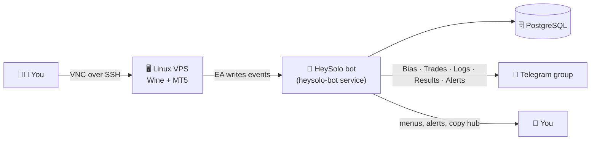

<div dir="rtl" align="center">


# HeySolo

**متاتریدر ۵ را روی سرور خودتان اجرا کنید. از تلگرام کنترلش کنید.**

یک مدیر تک‌دستوری که یک VPS ساده‌ی Debian/Ubuntu را به سرور آماده‌ی MT5 تبدیل می‌کند و یک ربات تلگرام برای هشدار، ژورنال معاملات، پیگیری چالش پراپ و کپی ترید به شما می‌دهد.

</div>

<div align="center">

[](#-پیش‌نیازها)
[](#-چه-چیزی-دریافت-می‌کنید)
[](#مرحله-۳--اتصال-ربات-تلگرام)
[](#-لایسنس)
[](https://github.com/Mahersaber2024/Heysolo/stargazers)

[English](README.md) · **فارسی** · [نسخه Lite (بدون سرور)](Hey-Solo-Lite/README_FA.md)

</div>

---

<div dir="rtl">

## ✨ چه چیزی دریافت می‌کنید

| | |
|---|---|
| 🖥️ **MT5 روی لینوکس** | Wine، نمایشگر مجازی و VNC خودکار نصب می‌شوند. نیازی به ویندوز سرور نیست. |
| 🧩 **چند ترمینال روی یک سرور** | نصب، روشن، خاموش، ری‌استارت، مخفی کردن و حذف ترمینال‌ها از یک پنل. |
| 🤖 **ربات تلگرام** | رویدادهای اکسپرت در تاپیک‌های جدا می‌رسند: بایاس، معاملات، لاگ‌ها، نتایج و هشدارها. |
| 🏆 **پنل چالش پراپ** | قوانین، دراودان و پیشرفت تارگت زنده، همراه با هشدار نزدیک شدن به حد و پاس یا فِیل شدن. |
| ⚡ **Copy Hub** | کپی معامله از یک حساب (مستر) به حساب‌های دیگر (فالوور) از طریق ربات. |
| 💾 **بکاپ و بازیابی** | بکاپ، بازیابی بعد از ریبوت، عیب‌یابی و حذف تمیز. |
| 🌐 **فارسی و انگلیسی** | ربات هر دو زبان را بلد است و هر کاربر زبان خودش را انتخاب می‌کند. |

## 🧭 نسخه‌ی خود را انتخاب کنید

| | **HeySolo Manager** *(همین صفحه)* | **HeySolo Lite** |
|---|---|---|
| محل اجرا | VPS لینوکسی شما | Cloudflare Worker |
| میزبانی MT5 | ✅ خودش MT5 را نصب و اجرا می‌کند | ❌ MT5 را خودتان دارید (PC یا VPS) |
| ربات تلگرام | ✅ ربات پایتون با PostgreSQL | ✅ Worker با دیتابیس D1 |
| نیاز به سرور | بله | **خیر** (فقط مرورگر) |
| مناسب برای | ترمینال ۲۴ ساعته و کنترل کامل | شروع سریع، Copy Hub، ژورنال و هشدار |
| راهنما | همین صفحه 👇 | [**راهنمای Lite ←**](Hey-Solo-Lite/README_FA.md) |

</div>

## 🏗️ ساختار کلی



<div dir="rtl">

## 📋 پیش‌نیازها

| | حداقل برای یک ترمینال |
|---|---|
| سیستم‌عامل | Debian 11+ یا Ubuntu 22.04+ (معماری x86_64) |
| CPU / RAM | ۱ vCPU / ۱ گیگابایت (۲ گیگابایت Swap پیشنهاد می‌شود) |
| دیسک | ۲۰ گیگابایت فضای خالی |
| دسترسی | `root` یا کاربری با `sudo` |
| شبکه | اینترنت برای دانلود پکیج‌ها و نصب‌کننده‌ها |
| برای ربات | توکن ربات از [@BotFather](https://t.me/BotFather) و آیدی عددی خودتان از [@userinfobot](https://t.me/userinfobot) |

> اکسپرت‌های سنگین، نمودارهای زیاد، بک‌تست یا چند ترمینال به CPU و RAM بیشتری نیاز دارند.

## 🚀 شروع سریع

همه‌چیز از یک پنل انجام می‌شود. با چهار مرحله آماده‌اید.

### مرحله ۱ · باز کردن پنل

با کاربر root اجرا کنید:

</div>

```bash
bash <(curl -fsSL https://raw.githubusercontent.com/Mahersaber2024/Heysolo/main/heysolo.sh)
```

<div dir="rtl">

این دستور، فرمان `heysolo` را نصب می‌کند. از این به بعد فقط بزنید:

</div>

```bash
sudo heysolo
```

<div dir="rtl">

### مرحله ۲ · آماده‌سازی سرور و افزودن ترمینال

در پنل:

1. کلید **`P`** را بزنید تا سرور آماده شود (Wine، نمایشگر، VNC، دسکتاپ). در این مرحله رمز VNC را تعیین می‌کنید. اجرای دوباره‌اش بی‌خطر است و فقط موارد ناقص را تکرار می‌کند.
2. کلید **`I`** را بزنید تا اولین ترمینال MT5 نصب شود. برای افزودن ترمینال بعدی دوباره `I` بزنید.

می‌خواهید پنجره‌ی MT5 را ببینید؟ از **کامپیوتر خودتان** یک تونل SSH باز کنید و بعد با VNC وصل شوید:

</div>

```bash
ssh -L 5900:localhost:5900 mt5user@SERVER_IP
```

<div dir="rtl">

برنامه‌ی [RealVNC Viewer](https://www.realvnc.com/en/connect/download/viewer/) را به `localhost:5900` وصل کنید.

> 🔒 اتصال VNC عمداً از تونل SSH انجام می‌شود تا پورت VNC لازم نباشد روی اینترنت باز بماند.

### مرحله ۳ · اتصال ربات تلگرام

در پنل کلید **`T`** (نصب ربات) را بزنید. نصب‌کننده این موارد را می‌پرسد:

| سؤال | چه چیزی وارد کنید |
|---|---|
| رمز PostgreSQL | یک رمز جدید برای کاربر دیتابیس ربات (خود دیتابیس ساخته می‌شود) |
| Telegram Bot Token | توکن @BotFather (الزامی، هنگام تایپ نمایش داده نمی‌شود) |
| Telegram Chat ID | آیدی گروه گزارش، با `-100` شروع می‌شود (الزامی) |
| Admin IDs | آیدی عددی تلگرام خودتان؛ برای چند ادمین با کاما جدا کنید (اختیاری) |
| Common Files path | خالی بگذارید تا بعداً تنظیم شود |
| MT5 server setup | اگر MT5 روی همین سرور است گزینه **۱** را بزنید (خودکار پیدا می‌شود) |

بعد ربات را در تلگرام باز کنید و `/start` بفرستید.

**آماده‌سازی گروه گزارش (همان گروهی که آیدی‌اش را وارد کردید):**

1. یک گروه تلگرام بسازید و **Topics** را روشن کنید.
2. ربات را با دسترسی **Manage Topics** ادمین گروه کنید.
3. در ربات به مسیر **⚙️ Admin ← 📓 Chat Journal ← Set group** بروید و آیدی گروه را بفرستید. اگر گروه از قبل تنظیم شده، **Create missing topics** را بزنید.

ربات خودش تاپیک‌های **بایاس، معاملات، لاگ‌ها، نتایج و هشدارها** را می‌سازد.

### مرحله ۴ · بارگذاری اکسپرت

در پنل کلید **`M`** را بزنید تا فایل‌های MQL5 (Experts، Include، Indicators، set و Templates) در همه‌ی ترمینال‌ها همگام شوند. سپس در MT5:

1. **Algo Trading** را روشن کنید.
2. در پنل اکسپرت وارد بخش **Telegram** شوید و **Send Via** را روی `SEND PY BOT / BRIDGE EA` بگذارید.
3. هر کدام از **Send Trade**، **Send Result** و **send Logs** را که لازم دارید روشن کنید. هشدار قیمت هم از همین کلیدها استفاده می‌کند: اگر حداقل یکی روشن باشد، هشدار ارسال می‌شود.

تمام. معاملات، نتایج، لاگ‌ها و هشدارهای قیمت حالا در تاپیک‌های خودشان در تلگرام می‌آیند.

## 🎛️ استفاده‌ی روزانه

پنل را با `sudo heysolo` باز کنید.

| کلید | کار |
|---|---|
| `1`…`9` | روشن یا خاموش کردن آن ترمینال |
| `R1` · `D1` · `K1` | ری‌استارت · نمایش روی دسکتاپ یا پس‌زمینه · حذف ترمینال ۱ |
| `A` · `Z` · `V` | روشن کردن همه · خاموش کردن همه · VNC روشن/خاموش |
| `P` · `I` · `M` | آماده‌سازی سرور · نصب/افزودن ترمینال · همگام‌سازی فایل‌های MQL5 |
| `S` | Wine compliance (استاندارد کردن محیط ویندوز برای MT5) |
| `T` · `B` · `L` | نصب ربات · ری‌استارت ربات · لاگ زنده‌ی ربات |
| `?` · `U` · `X` · `Q` | عیب‌یابی · آپدیت اسکریپت‌ها · حذف · خروج |

فایل‌های MQL5 در آپدیت‌های معمولی حفظ می‌شوند و فقط وقتی همگام‌سازی اجباری بزنید بازنویسی می‌شوند.

## 🗂️ فایل‌ها کجا هستند

</div>

```text
/opt/heysolo/scripts       Manager scripts
/opt/heysolo/bot           Bot runtime files and settings (heysolo_settings.json)
/opt/heysolo/bot/MT5       Put your MQL5 files here, then press M
/opt/heysolo/bot/Meta5     MT5 installers and local terminal files
/etc/heysolo-mt5           Terminal state and configuration
```

<div dir="rtl">

ربات به‌صورت سرویس systemd با نام `heysolo-bot` اجرا می‌شود:

</div>

```bash
systemctl status heysolo-bot
journalctl -u heysolo-bot -f
```

<div dir="rtl">

## 🛠️ عیب‌یابی

<details>
<summary><b>پنل پیام «mt5.sh not found» می‌دهد</b></summary>

کلید **`U`** را بزنید تا اسکریپت‌ها آپدیت شوند، سپس پنل را دوباره باز کنید.
</details>

<details>
<summary><b>ربات در تلگرام جواب نمی‌دهد</b></summary>

با **`L`** لاگ زنده را ببینید. درستی توکن، حضور آیدی خودتان در لیست ادمین‌ها و اینکه در چت خصوصی با ربات هستید را بررسی کنید. با **`B`** ربات را ری‌استارت کنید.
</details>

<details>
<summary><b>از اکسپرت چیزی نمی‌رسد</b></summary>

بررسی کنید **Send Via** روی `SEND PY BOT / BRIDGE EA` باشد، حداقل یکی از Send Trade / Send Result / send Logs روشن باشد و حساب به کاربر ربات وصل باشد. خطی مثل `Dropping outbox event ... no delivery targets` در لاگ یعنی رویداد گیرنده‌ای نداشته است.
</details>

<details>
<summary><b>به VNC وصل نمی‌شوم</b></summary>

VNC از تونل SSH روی پورت ۵۹۰۰ در دسترس است، نه روی IP عمومی. اول تونل `ssh -L 5900:localhost:5900 ...` را باز کنید و بعد به `localhost:5900` وصل شوید. در پنل با **`V`** می‌توانید VNC را روشن کنید.
</details>

<details>
<summary><b>نصب نیمه‌کاره ماند</b></summary>

با **`?`** عیب‌یابی را اجرا کنید. مرحله‌ی ۱ (`P`) را می‌توانید بی‌خطر دوباره اجرا کنید. لاگ‌ها در مسیری که پنل نشان می‌دهد ذخیره می‌شوند.
</details>

## 🔐 امنیت

- هیچ‌وقت رمز، توکن، کلید خصوصی، سرتیفیکیت، اطلاعات مشتری یا فایل واقعی `heysolo_settings.json` را در مخزن نگذارید.
- از یک کاربر اختصاصی روی سرور استفاده کنید، VNC را پشت تونل SSH نگه دارید، دسترسی SSH را محدود کنید و سیستم را به‌روز نگه دارید.
- هر اسکریپت شل را، از جمله همین یکی را، قبل از اجرا با دسترسی root بخوانید.

## 📦 نقشه‌ی مخزن

</div>

```text
heysolo.sh · install.sh · mt5.sh · uninstall.sh   Panel, bot installer, MT5 manager, uninstaller
heysolo_bot.py · language.py · ea_settings.py     Telegram bot, texts, EA settings screen
db/ · prop/ · copier/ · biasfeed/ · backup/        Database, prop panel, Copy Hub, bias feed, backups
MT5/                                               EA, include files, indicators, sets, templates
win/                                               Wine compliance scripts
Hey-Solo-Lite/                                     Cloudflare Worker edition (no server)
```

<div dir="rtl">

## 📄 لایسنس

HeySolo تحت **HeySolo Custom Source-Available License** منتشر شده است (فایل [`LICENSE`](LICENSE)).

- ✅ نصب و استفاده‌ی شخصی یا داخلی و fork برای توسعه مجاز است.
- 🚫 انتشار مجدد، فروش، ارائه‌ی عمومی به‌صورت سرویس و استفاده‌ی تجاری بدون اجازه‌ی کتبی صاحب اثر ممنوع است.

این لایسنس source-available است و تأیید OSI ندارد. متاتریدر ۵، Wine، توزیع‌های لینوکس و سایر ابزارهای جانبی تابع لایسنس خودشان هستند.

</div>

<div align="center">

**ساخته‌شده برای معامله‌گرانی که ترمینالِ بی‌دردسر و هشدارِ فوری می‌خواهند.**

</div>
