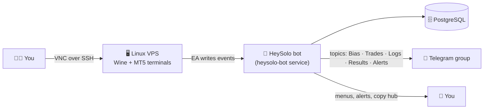

<div align="center">


# HeySolo

**Run MetaTrader 5 on your own server. Control it from Telegram.**

A one-command manager that turns a plain Debian/Ubuntu VPS into a ready MT5 trading box, plus a Telegram bot for alerts, a trade journal, prop-challenge tracking and copy trading.

[](#-requirements)
[](#-what-you-get)
[](#-step-3--connect-the-telegram-bot)
[](#-license)
[](https://github.com/Mahersaber2024/Heysolo/stargazers)

**English** · [فارسی](README.fa.md) · [Lite edition (no server)](Hey-Solo-Lite/README.md)

[Quick start](#-quick-start) · [Pick your edition](#-pick-your-edition) · [Daily use](#-daily-use) · [Troubleshooting](#-troubleshooting) · [Security](#-security)

</div>

---

## ✨ What you get

| | |
|---|---|
| 🖥️ **MT5 on Linux** | Wine, a virtual display and VNC are set up for you. No Windows server needed. |
| 🧩 **Many terminals, one server** | Install, start, stop, restart, hide or remove terminals from a single panel. |
| 🤖 **Telegram bot** | Events from your EA arrive in Telegram, sorted into topics: Bias, Trades, Logs, Results and Alerts. |
| 🏆 **Prop-challenge panel** | Live rules, drawdown and target progress, with warning and pass/fail alerts. |
| ⚡ **Copy Hub** | Copy trades from one account (Master) to others (Followers) through the bot. |
| 💾 **Backup and recovery** | Backups, boot recovery, diagnostics and a clean uninstall. |
| 🌐 **English and Persian** | The bot speaks both. Every user picks their own language. |

## 🧭 Pick your edition

HeySolo comes in two editions. Choose the one that fits how you trade.

| | **HeySolo Manager** *(this page)* | **HeySolo Lite** |
|---|---|---|
| Where it runs | Your Linux VPS | Cloudflare Worker |
| MT5 hosting | ✅ Installs and runs MT5 for you | ❌ You bring your own MT5 (PC or VPS) |
| Telegram bot | ✅ Python bot with PostgreSQL | ✅ Worker with D1 database |
| Needs a server | Yes | **No** (browser setup only) |
| Best for | 24/7 trading terminals, full control | Quick start, Copy Hub, journal and alerts |
| Guide | You are here 👇 | [**Open the Lite guide →**](Hey-Solo-Lite/README.md) |

## 🏗️ How it fits together



## 📋 Requirements

| | Minimum for one terminal |
|---|---|
| OS | Debian 11+ or Ubuntu 22.04+ (x86_64) |
| CPU / RAM | 1 vCPU / 1 GB (2 GB swap recommended) |
| Disk | 20 GB free |
| Access | `root` or a user with `sudo` |
| Network | Internet for packages and installers |
| For the bot | A Telegram bot token from [@BotFather](https://t.me/BotFather) and your numeric user ID from [@userinfobot](https://t.me/userinfobot) |

> Heavy EAs, many charts, backtesting or several terminals need more CPU and RAM.

## 🚀 Quick start

Everything is driven by one panel. Three steps and you are trading.

### Step 1 · Open the panel

Run as root:

```bash
bash <(curl -fsSL https://raw.githubusercontent.com/Mahersaber2024/Heysolo/main/heysolo.sh)
```

This installs the `heysolo` command. From now on, just run:

```bash
sudo heysolo
```

### Step 2 · Prepare the server and add a terminal

In the panel:

1. Press **`P`** to prepare the server (Wine, display, VNC, desktop). You will set a VNC password. Re-running it is safe and repeats only what is missing.
2. Press **`I`** to install your first MT5 terminal. Press `I` again any time to add more.

Want to see the MT5 window? Open an SSH tunnel from **your own computer**, then connect a VNC viewer:

```bash
ssh -L 5900:localhost:5900 mt5user@SERVER_IP
```

Connect [RealVNC Viewer](https://www.realvnc.com/en/connect/download/viewer/) to `localhost:5900`.

> 🔒 VNC is reached through the SSH tunnel on purpose, so the VNC port never has to be open to the internet.

### Step 3 · Connect the Telegram bot

In the panel press **`T`** (bot setup). The installer asks you for:

| Prompt | What to enter |
|---|---|
| PostgreSQL password | A new password for the bot's database role (the database is created for you) |
| Telegram Bot Token | The token from @BotFather (required, input is hidden) |
| Telegram Chat ID | Your reporting group ID, starts with `-100` (required) |
| Admin IDs | Your numeric Telegram user ID, comma separated for several admins (optional) |
| Common Files path | Leave empty to set it later |
| MT5 server setup | Choose **1** when MT5 runs on this same server (auto-detected) |

Then open your bot in Telegram and send `/start`.

**Prepare the reporting group (the one whose ID you entered above):**

1. Create a Telegram group and enable **Topics**.
2. Add your bot as admin with the **Manage Topics** permission.
3. In the bot open **⚙️ Admin → 📓 Chat Journal → Set group** and send the group ID. If the group is already set, use **Create missing topics**.

The bot creates the **Bias, Trades, Logs, Results and Alerts** topics by itself.

### Step 4 · Load the EA

Press **`M`** in the panel to sync the MQL5 files (Experts, Include, Indicators, sets, Templates) into every terminal. In MT5:

1. Turn on **Algo Trading**.
2. In the EA panel open **Telegram** and set **Send Via** to `SEND PY BOT / BRIDGE EA`.
3. Switch on **Send Trade**, **Send Result** and **send Logs** as you like. Price alerts also use these switches: an alert is sent when at least one of them is on.

That is it. Trades, results, logs and price alerts now land in their own Telegram topics.

## 🎛️ Daily use

Open the panel with `sudo heysolo`.

| Key | Action |
|---|---|
| `1`…`9` | Start or stop that terminal |
| `R1` · `D1` · `K1` | Restart · show on desktop or background · remove terminal 1 |
| `A` · `Z` · `V` | Start all · stop all · VNC on/off |
| `P` · `I` · `M` | Prepare server · install/add terminal · sync MQL5 files |
| `S` | Wine compliance (standardise the Windows environment for MT5) |
| `T` · `B` · `L` | Bot setup · restart bot · live bot logs |
| `?` · `U` · `X` · `Q` | Doctor (diagnostics) · update scripts · uninstall · quit |

MQL5 files are kept during routine updates. They are only overwritten when you explicitly force a sync.

## 🗂️ Where things live

```text
/opt/heysolo/scripts       Manager scripts
/opt/heysolo/bot           Bot runtime files and settings (heysolo_settings.json)
/opt/heysolo/bot/MT5       Put your MQL5 files here, then press M
/opt/heysolo/bot/Meta5     MT5 installers and local terminal files
/etc/heysolo-mt5           Terminal state and configuration
```

The bot runs as the systemd service `heysolo-bot`:

```bash
systemctl status heysolo-bot
journalctl -u heysolo-bot -f
```

## 🛠️ Troubleshooting

<details>
<summary><b>The panel says "mt5.sh not found"</b></summary>

Press **`U`** to update scripts, then re-open the panel.
</details>

<details>
<summary><b>The bot does not answer in Telegram</b></summary>

Press **`L`** for the live log. Check that the token is correct, that your user ID is in the admin list, and that you are chatting with the bot privately. Restart it with **`B`**.
</details>

<details>
<summary><b>Nothing arrives from the EA</b></summary>

Check that **Send Via** is `SEND PY BOT / BRIDGE EA`, that at least one of Send Trade / Send Result / send Logs is on, and that the account is linked to your bot user. A line in the bot log like `Dropping outbox event ... no delivery targets` tells you the event had nobody to go to.
</details>

<details>
<summary><b>I cannot reach VNC</b></summary>

VNC listens through the SSH tunnel on port 5900, not on the public IP. Open the `ssh -L 5900:localhost:5900 ...` tunnel first, then connect to `localhost:5900`. Press **`V`** in the panel to turn VNC on.
</details>

<details>
<summary><b>Something is half-installed</b></summary>

Press **`?`** to run the doctor. Step 1 (`P`) is safe to run again. Logs are written to the path the panel prints.
</details>

## 🔐 Security

- Never commit passwords, tokens, private keys, certificates, customer data or live `heysolo_settings.json` files.
- Use a dedicated server user, keep VNC behind the SSH tunnel, restrict SSH and keep the OS updated.
- Read any shell script before running it as root, including this one.

## 📦 Repository map

```text
heysolo.sh · install.sh · mt5.sh · uninstall.sh   Panel, bot installer, MT5 manager, uninstaller
heysolo_bot.py · language.py · ea_settings.py     Telegram bot, texts, EA settings screen
db/ · prop/ · copier/ · biasfeed/ · backup/        Database, prop panel, Copy Hub, bias feed, backups
MT5/                                               EA, include files, indicators, sets, templates
win/                                               Wine compliance scripts
Hey-Solo-Lite/                                     Cloudflare Worker edition (no server)
```

## 📄 License

HeySolo is released under the **HeySolo Custom Source-Available License** (see [`LICENSE`](LICENSE)).

- ✅ Install and use it personally or internally, and fork it for development.
- 🚫 Redistribution, resale, public hosting and commercial use need written permission from the copyright holder.

This is source-available, not an OSI-approved open-source license. MetaTrader 5, Wine, Linux distributions and other third-party assets keep their own licenses.

<div align="center">

**Built for traders who like their terminals boring and their alerts instant.**

</div>
